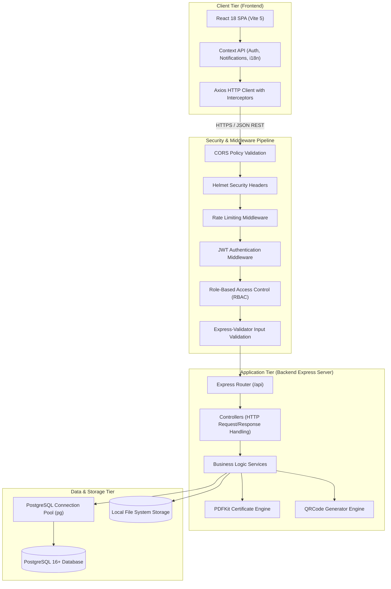
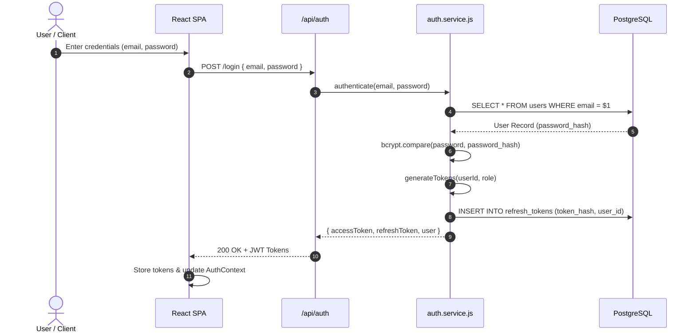
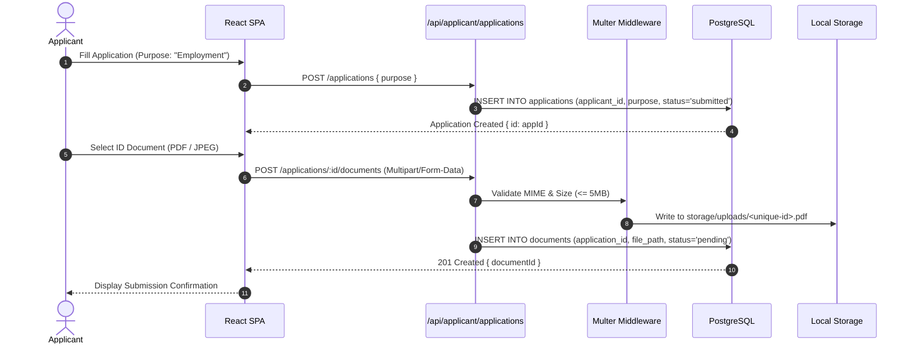
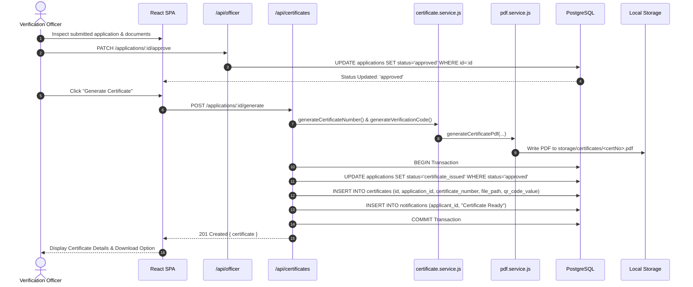
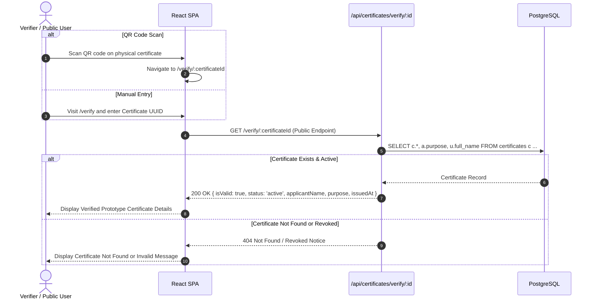

# EthioClear — System Architecture

> **Academic Prototype Notice:**  
> EthioClear is a university graduation-project prototype developed for academic demonstration. It is not an official Ethiopian government system, does not integrate with real government databases, and produces prototype certificates marked for demonstration purposes only.

---

## 1. High-Level Architectural Overview

EthioClear is structured as a decoupled, multi-tier web application following a service-oriented, layered architecture. The system separates user interface concerns, application business logic, relational data persistence, and static document generation.

---

## 2. Core Architectural Layers

### 2.1 Presentation Tier (Frontend)
- **Technology:** React 18, Vite 5, Tailwind CSS, React Router 6.
- **State Management:**
  - `AuthContext`: Manages access tokens, decoded user profiles, and session persistence in `localStorage`.
  - `LanguageContext`: Provides client-side internationalization across 5 Ethiopian languages (Amharic, Afaan Oromo, Tigrinya, Afar, and English).
  - `NotificationContext`: Manages in-app status updates and unread counters with automatic polling.
- **Communication Layer:** A centralized Axios instance (`api.js`) handles base URLs, sets Authorization Bearer headers, and handles token expiration transparently.

### 2.2 Security & Routing Tier
- **Express Router:** Modular endpoint mounting under the `/api` prefix:
  - `/api/auth`: Registration, authentication, token refresh, password reset.
  - `/api/applicant`: Application submission, document uploads, application history.
  - `/api/officer`: Review queue, applicant detail inspection, approval, rejection.
  - `/api/admin`: User management, officer provisioning, audit trail, statistics.
  - `/api/certificates`: Generation, authorized PDF download, public verification.
  - `/api/notifications`: User notifications and read status tracking.
  - `/api/health`: Health monitoring and uptime checks.
- **Middleware Pipeline:**
  1. `helmet`: Sets HTTP security headers (XSS filtering, frameguard, HSTS).
  2. `cors`: Dynamic origin validation supporting local development and production deployments.
  3. `rateLimiter`: Protects against brute-force attacks on sensitive endpoints.
  4. `auth.middleware`: Decodes and cryptographically verifies JWT access tokens.
  5. `rbac.middleware`: Validates role claims against route-level permission policies.
  6. `validate.middleware`: Formats input validation errors into uniform API responses.

### 2.3 Application & Business Logic Tier
- **Controllers:** Extract HTTP request payloads, route them to appropriate services, and return normalized JSON responses.
- **Services:** Pure business logic decoupled from HTTP frameworks. Enforces business rules (e.g., verifying an application is approved before issuing a certificate).
- **Engines:**
  - `PDFKit Engine`: Dynamically builds vector-based A4 certificate documents with Ethiopian font rendering and prototype disclaimers.
  - `QR Engine`: Encodes system-internal verification URLs into PNG image buffers embedded into certificates.

### 2.4 Data & Storage Tier
- **Database:** PostgreSQL 16+ accessed via the `pg` connection pool with parameter binding for SQL injection protection.
- **File System Storage:**
  - `storage/uploads/`: Stores applicant-submitted ID documents and passport photos.
  - `storage/certificates/`: Stores generated prototype PDF certificates.
  - `storage/temp/`: Ephemeral directory for processing files.

---

## 3. Detailed Workflow Sequence Diagrams

### 3.1 Authentication & Token Refresh Lifecycle

---

### 3.2 Application Submission & Document Upload Flow

---

### 3.3 Application Review & Transactional Certificate Issuance

---

### 3.4 Public Certificate Verification Flow

---

## 4. Security Architecture

1. **Defense-in-Depth Authorization:** Role checks occur at two distinct stages:
   - Client-side navigation guards (`ProtectedRoute.jsx`) prevent unauthorized UI access.
   - Server-side middleware (`rbac.middleware.js`) validates JWT claims before controllers execute.
2. **Atomic Issuance Guarantees:** Database transactions (`BEGIN ... COMMIT`) ensure application status changes and certificate records cannot diverge.
3. **Storage Isolation:** Uploaded applicant files and generated certificates are isolated in dedicated directories not directly browsable over static HTTP routes. Downloads require authenticated API calls with permission checks.
4. **Auditability:** Critical actions (approvals, rejections, user status modifications) automatically insert immutable records into the `audit_logs` table with actor identification, IP addresses, and metadata.
