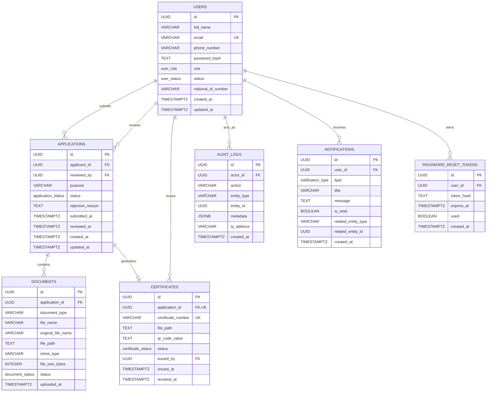

# EthioClear — Database Schema & Data Dictionary

> **Academic Prototype Notice:**  
> This schema is designed specifically for an academic graduation project demonstrating digital criminal record certificate management. It models a simulated workflow and has no connection to actual Ethiopian government systems.

---

## 1. Overview & Technical Specifications

- **Database Engine:** PostgreSQL 16+
- **Extensions:** `pgcrypto` (used for `gen_random_uuid()` primary keys)
- **Normal Form:** 3rd Normal Form (3NF)
- **Primary Key Convention:** Universally Unique Identifiers (`UUIDv4`) across all primary entities
- **Timestamp Standard:** `TIMESTAMPTZ` (UTC)

---

## 2. PostgreSQL Enumerated Types (ENUMs)

To enforce strict domain integrity at the database engine level, the following enums are defined:

| Enum Name | Allowed Values | Usage / Description |
|---|---|---|
| `user_role` | `'applicant'`, `'officer'`, `'admin'` | Controls role-based access permissions |
| `user_status` | `'active'`, `'suspended'`, `'deactivated'` | Account lifecycle states |
| `application_status` | `'submitted'`, `'under_review'`, `'approved'`, `'rejected'`, `'certificate_issued'` | Linear state-machine for clearance requests |
| `document_status` | `'pending'`, `'verified'`, `'rejected'` | Per-document verification status |
| `certificate_status` | `'active'`, `'revoked'` | Certificate validity status |
| `notification_type` | `'status_update'`, `'document_request'`, `'system_message'` | User alert classification |

---

## 3. Entity-Relationship (ER) Diagram

---

## 4. Detailed Table Specifications

### 4.1 `users` Table
Stores all user accounts across applicants, verification officers, and administrators.

| Column Name | Data Type | Nullable | Constraints & Defaults | Description |
|---|---|---|---|---|
| `id` | `UUID` | No | `PRIMARY KEY`, default `gen_random_uuid()` | Unique user identifier |
| `full_name` | `VARCHAR(150)` | No | — | User's legal full name |
| `email` | `VARCHAR(255)` | No | `UNIQUE`, `CHECK (email ~* '^[A-Za-z0-9._%+-]+@[A-Za-z0-9.-]+\.[A-Za-z]{2,}$')` | Login email address |
| `phone_number` | `VARCHAR(20)` | Yes | — | Contact telephone number |
| `password_hash` | `TEXT` | No | — | Bcrypt password hash (cost factor 12) |
| `role` | `user_role` | No | Default `'applicant'` | Role classification (`applicant`, `officer`, `admin`) |
| `status` | `user_status` | No | Default `'active'` | Account state (`active`, `suspended`, `deactivated`) |
| `national_id_number` | `VARCHAR(50)` | Yes | — | Fictional/demo Ethiopian ID number |
| `created_at` | `TIMESTAMPTZ` | No | Default `now()` | Record creation timestamp |
| `updated_at` | `TIMESTAMPTZ` | No | Default `now()`, managed by trigger | Record modification timestamp |

*Indexes:* `idx_users_role`, `idx_users_status`, `idx_users_email`.

---

### 4.2 `applications` Table
Represents certificate clearance applications submitted by registered applicants.

| Column Name | Data Type | Nullable | Constraints & Defaults | Description |
|---|---|---|---|---|
| `id` | `UUID` | No | `PRIMARY KEY`, default `gen_random_uuid()` | Unique application identifier |
| `applicant_id` | `UUID` | No | `FOREIGN KEY (users.id) ON DELETE CASCADE` | Reference to applicant account |
| `reviewed_by` | `UUID` | Yes | `FOREIGN KEY (users.id) ON DELETE SET NULL` | Officer who reviewed the request |
| `purpose` | `VARCHAR(255)` | No | — | Justification (e.g., Employment, Visa, University) |
| `status` | `application_status` | No | Default `'submitted'` | Workflow stage |
| `rejection_reason` | `TEXT` | Yes | — | Justification required if status is `'rejected'` |
| `submitted_at` | `TIMESTAMPTZ` | No | Default `now()` | Application submission timestamp |
| `reviewed_at` | `TIMESTAMPTZ` | Yes | — | Timestamp of officer action |
| `created_at` | `TIMESTAMPTZ` | No | Default `now()` | Record creation timestamp |
| `updated_at` | `TIMESTAMPTZ` | No | Default `now()`, managed by trigger | Record modification timestamp |

*Check Constraints:*
- `chk_reviewed_consistency`: `(status IN ('submitted') AND reviewed_by IS NULL AND reviewed_at IS NULL) OR (status NOT IN ('submitted'))`
- `chk_rejection_reason`: `(status = 'rejected' AND rejection_reason IS NOT NULL) OR (status <> 'rejected')`

*Indexes:* `idx_applications_applicant_id`, `idx_applications_status`, `idx_applications_reviewed_by`, `idx_applications_submitted_at`.

---

### 4.3 `documents` Table
Stores metadata for uploaded supporting files (e.g., National ID card scan, passport-size photo).

| Column Name | Data Type | Nullable | Constraints & Defaults | Description |
|---|---|---|---|---|
| `id` | `UUID` | No | `PRIMARY KEY`, default `gen_random_uuid()` | Unique document record identifier |
| `application_id` | `UUID` | No | `FOREIGN KEY (applications.id) ON DELETE CASCADE` | Associated application |
| `document_type` | `VARCHAR(100)` | No | — | Type label (e.g., "National ID", "Passport Photo") |
| `file_name` | `VARCHAR(255)` | No | — | Securely generated storage filename |
| `original_file_name` | `VARCHAR(255)` | No | — | User's original file upload name |
| `file_path` | `TEXT` | No | — | Relative path under `storage/uploads/` |
| `mime_type` | `VARCHAR(100)` | No | `CHECK (mime_type IN ('application/pdf', 'image/jpeg', 'image/png'))` | Allowed document MIME type |
| `file_size_bytes` | `INTEGER` | No | `CHECK (file_size_bytes > 0)` | File payload size in bytes |
| `status` | `document_status` | No | Default `'pending'` | Review status (`pending`, `verified`, `rejected`) |
| `uploaded_at` | `TIMESTAMPTZ` | No | Default `now()` | Upload timestamp |

*Indexes:* `idx_documents_application_id`, `idx_documents_status`.

---

### 4.4 `certificates` Table
Stores issued prototype certificates, their serial numbers, generated PDF references, and verification metadata.

| Column Name | Data Type | Nullable | Constraints & Defaults | Description |
|---|---|---|---|---|
| `id` | `UUID` | No | `PRIMARY KEY`, default `gen_random_uuid()` | Unique certificate identifier (used in QR URL) |
| `application_id` | `UUID` | No | `UNIQUE`, `FOREIGN KEY (applications.id) ON DELETE CASCADE` | Associated approved application |
| `certificate_number` | `VARCHAR(50)` | No | `UNIQUE` | Formatted certificate reference code (`ECL-YYYY-XXXXXXXX`) |
| `file_path` | `TEXT` | No | — | Relative path under `storage/certificates/` |
| `qr_code_value` | `TEXT` | No | — | Verification URL encoded in the QR code |
| `status` | `certificate_status` | No | Default `'active'` | Certificate status (`active`, `revoked`) |
| `issued_by` | `UUID` | Yes | `FOREIGN KEY (users.id) ON DELETE SET NULL` | Officer/admin who triggered issuance |
| `issued_at` | `TIMESTAMPTZ` | No | Default `now()` | Generation timestamp |
| `revoked_at` | `TIMESTAMPTZ` | Yes | — | Revocation timestamp (if applicable) |

*Check Constraints:*
- `chk_revoked_consistency`: `(status = 'revoked' AND revoked_at IS NOT NULL) OR (status = 'active' AND revoked_at IS NULL)`

*Indexes:* `idx_certificates_application_id`, `idx_certificates_status`.

---

### 4.5 `audit_logs` Table
Append-only log recording security and administrative actions.

| Column Name | Data Type | Nullable | Constraints & Defaults | Description |
|---|---|---|---|---|
| `id` | `UUID` | No | `PRIMARY KEY`, default `gen_random_uuid()` | Unique audit log entry ID |
| `actor_id` | `UUID` | Yes | `FOREIGN KEY (users.id) ON DELETE SET NULL` | Performing user ID |
| `action` | `VARCHAR(100)` | No | — | Action tag (e.g., `APPLICATION_APPROVED`) |
| `entity_type` | `VARCHAR(50)` | No | — | Target entity (e.g., `application`, `user`) |
| `entity_id` | `UUID` | Yes | — | Primary key of affected entity |
| `metadata` | `JSONB` | Yes | — | Structured contextual payload |
| `ip_address` | `VARCHAR(45)` | Yes | — | Client IPv4 / IPv6 address |
| `created_at` | `TIMESTAMPTZ` | No | Default `now()` | Timestamp of event |

*Indexes:* `idx_audit_logs_actor_id`, `idx_audit_logs_entity`, `idx_audit_logs_created_at`.

---

### 4.6 `notifications` Table
User-facing alert messages regarding application status changes.

| Column Name | Data Type | Nullable | Constraints & Defaults | Description |
|---|---|---|---|---|
| `id` | `UUID` | No | `PRIMARY KEY`, default `gen_random_uuid()` | Unique notification ID |
| `user_id` | `UUID` | No | `FOREIGN KEY (users.id) ON DELETE CASCADE` | Recipient user ID |
| `type` | `notification_type` | No | — | Classification (`status_update`, etc.) |
| `title` | `VARCHAR(150)` | No | — | Brief alert headline |
| `message` | `TEXT` | No | — | Detailed message body |
| `is_read` | `BOOLEAN` | No | Default `FALSE` | Read / unread status flag |
| `related_entity_type`| `VARCHAR(50)` | Yes | — | Reference entity type (e.g., `application`) |
| `related_entity_id` | `UUID` | Yes | — | Reference entity primary key |
| `created_at` | `TIMESTAMPTZ` | No | Default `now()` | Message arrival timestamp |

*Indexes:* `idx_notifications_user_id`, `idx_notifications_is_read`.

---

### 4.7 `password_reset_tokens` Table
Handles secure, time-limited, single-use password recovery requests.

| Column Name | Data Type | Nullable | Constraints & Defaults | Description |
|---|---|---|---|---|
| `id` | `UUID` | No | `PRIMARY KEY`, default `gen_random_uuid()` | Unique token record ID |
| `user_id` | `UUID` | No | `FOREIGN KEY (users.id) ON DELETE CASCADE` | Requesting user |
| `token_hash` | `TEXT` | No | — | SHA-256 hash of the recovery token |
| `expires_at` | `TIMESTAMPTZ` | No | — | Expiration timestamp |
| `used` | `BOOLEAN` | No | Default `FALSE` | Single-use invalidation flag |
| `created_at` | `TIMESTAMPTZ` | No | Default `now()` | Request timestamp |

*Indexes:* `idx_password_reset_tokens_token_hash`, `idx_password_reset_tokens_user_id`.

---

## 5. Development Seed Accounts

The development seed file (`src/database/seed.sql`) provides pre-configured test users representing every system role.

**Universal Demo Password:** `Demo@1234`

| Role | Name | Email Address | Purpose / Preloaded State |
|---|---|---|---|
| **Administrator** | Selam Tesfaye | `admin@ethioclear.test` | System oversight, user suspension, audit logs |
| **Verification Officer** | Bekele Girma | `officer1@ethioclear.test` | Assigned to review queue and application actions |
| **Verification Officer** | Marta Alemu | `officer2@ethioclear.test` | Approved application with generated certificate |
| **Applicant** | Yonas Kebede | `applicant1@ethioclear.test` | Has 1 submitted application awaiting review |
| **Applicant** | Hana Worku | `applicant2@ethioclear.test` | Has 1 rejected application with feedback |
| **Applicant** | Dawit Mulugeta | `applicant3@ethioclear.test` | Has 1 approved application with ready certificate |
